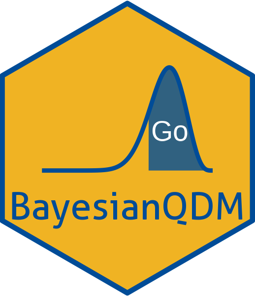

<!-- README.md is generated from README.Rmd. Please edit that file and run devtools::build_readme(). -->

# BayesianQDM 

<!-- badges: start -->

[](https://cran.r-project.org/package=BayesianQDM)
[](https://cran.r-project.org/package=BayesianQDM)
[](https://cran.r-project.org/package=BayesianQDM)
[](https://github.com/gosukehommaEX/BayesianQDM/actions/workflows/R-CMD-check.yaml)
[](https://app.codecov.io/gh/gosukehommaEX/BayesianQDM?branch=main)
[](https://lifecycle.r-lib.org/articles/stages.html#stable)
<!-- badges: end -->

## Overview

BayesianQDM implements Bayesian quantitative decision-making (QDM) for
proof-of-concept (PoC) clinical trials (Kang, Yamaguchi and Han, 2026).
The data of a PoC study lead to one of three decisions: Go (proceed to
the next phase), NoGo (stop the development) or Gray (the evidence is
not sufficient for either). The criteria compare the posterior or
posterior predictive probability of the treatment effect with
thresholds, for a target value (TV) and a minimum acceptable value (MAV)
of the effect.

The package answers four questions for a planned or completed study:

- Which decision do the observed data lead to? (`qdm_decide()`)
- How often does the design lead to each decision when the true effect
  is known? (`qdm_oc()`)
- Which thresholds keep the probabilities of a false Go and a false NoGo
  decision below given targets? (`qdm_calibrate()`)
- Which observed data lead to each decision? (`qdm_boundary()`)

A study is described by small specification objects (priors, data,
external data borrowed through a power prior, a hypothetical control and
a decision criterion), which are combined into a design.

| Endpoints | Design | Model | Computation of the probabilities |
|----|----|----|----|
| One binary | `design_binary()` | Beta-binomial | Numerical integration (posterior), exact sum (predictive) |
| One continuous | `design_continuous()` | Normal-Inverse-chi-squared or vague | Numerical integration, moment matching or Monte Carlo |
| Two binary | `design_binary2()` | Dirichlet-multinomial | Monte Carlo (posterior), exact sum (predictive) |
| Two continuous | `design_continuous2()` | Normal-Inverse-Wishart or vague | Moment matching or Monte Carlo |
| One time-to-event | `design_tte()` | Exponential with Gamma prior (milestone survival or hazard ratio) | Numerical integration or F distribution (posterior), simulation (predictive) |

The control group can be a concurrent control group, external control
data only, a hypothetical control, or a fixed value of the control
parameter (a single-arm study compared with a benchmark), and external
data can be borrowed for either group. Larger effects are favorable by
default; with `direction = "less"` in the criterion, smaller effects are
favorable, for example for the rate of an adverse event or a hazard
ratio.

## Installation

``` r
# From CRAN
install.packages("BayesianQDM")

# Development version from GitHub
# install.packages("pak")
pak::pak("gosukehommaEX/BayesianQDM")
```

## Example

A PoC study with one binary endpoint and 12 subjects in each group,
Jeffreys priors, and a posterior criterion with TV = 0.2 and MAV = 0.1:

``` r
des <- design_binary(
  n_t = 12, n_c = 12,
  prior_t = prior_beta(0.5, 0.5), prior_c = prior_beta(0.5, 0.5),
  criterion = criterion_posterior(theta_tv = 0.2, theta_mav = 0.1,
                                  gamma_go = 0.5, gamma_nogo = 0.8)
)
```

Decision for 9 responders in the treatment group and 4 in the control
group:

``` r
qdm_decide(des, data_t = data_binary(12, 9), data_c = data_binary(12, 4))
#> Decision: Go
#>   Go:   P(theta > 0.2 | data) = 0.8517 (threshold 0.5, met)
#>   NoGo: P(theta <= 0.1 | data) = 0.05935 (threshold 0.8, not met)
#> Posterior distributions
#>   Treatment: Beta(a = 9.5, b = 3.5)
#>   Control:   Beta(a = 4.5, b = 8.5)
```

Operating characteristics for true response rates of the treatment group
from 0.3 to 0.7 with a control rate of 0.3:

``` r
qdm_oc(des, data.frame(pi_t = seq(0.3, 0.7, by = 0.1), pi_c = 0.3))
#> Operating characteristics (exact enumeration of the outcomes)
#>  pi_t pi_c     Go    NoGo   Gray Miss
#>   0.3  0.3 0.1316 0.41696 0.4514    0
#>   0.4  0.3 0.2893 0.23249 0.4782    0
#>   0.5  0.3 0.4883 0.10937 0.4023    0
#>   0.6  0.3 0.6875 0.04137 0.2711    0
#>   0.7  0.3 0.8472 0.01150 0.1413    0
```

Thresholds for which the probability of meeting the Go criterion is at
most 0.05 when the treatment has no effect, and that of meeting the NoGo
criterion is at most 0.2 when the effect is 0.3:

``` r
qdm_calibrate(des,
              scenario_go = data.frame(pi_t = 0.3, pi_c = 0.3),
              scenario_nogo = data.frame(pi_t = 0.6, pi_c = 0.3),
              target_go = 0.05, target_nogo = 0.2)
#> Calibration of the decision thresholds (exact enumeration of the outcomes)
#>   gamma_go   = 0.74: P(Go criterion met | scenario_go) = 0.03587 (target 0.05)
#>   gamma_nogo = 0.39: P(NoGo criterion met | scenario_nogo) = 0.182 (target 0.2)
#> Decision probabilities with the chosen thresholds
#>       scenario pi_t pi_c      Go   NoGo   Gray Miss
#>    scenario_go  0.3  0.3 0.03587 0.7486 0.2155    0
#>  scenario_nogo  0.6  0.3 0.36483 0.1820 0.4531    0
```

Numbers of responders in the treatment group that lead to each decision,
for each number of responders in the control group, with the observed
response rates and differences in response rates:

``` r
qdm_boundary(des)
#> Decision boundary of a design with one binary endpoint
#>   n_t = 12, n_c = 12
#> 
#> Responders in the treatment group (y_t)
#>   y_c   NoGo   Gray    Go
#>   0     0      1-2     3-12
#>   1     0-1    2-3     4-12
#>   2     0-1    2-4     5-12
#>   3     0-2    3-5     6-12
#>   4     0-3    4-6     7-12
#>   5     0-4    5-7     8-12
#>   6     0-5    6-8     9-12
#>   7     0-6    7-9     10-12
#>   8     0-7    8-10    11-12
#>   9     0-8    9-11    12
#>   10    0-9    10-12   -
#>   11    0-11   12      -
#>   12    0-12   -       -
#> 
#> Observed response rate (y_t / n_t)
#>   y_c   NoGo             Gray              Go
#>   0     0.0%             8.3% to 16.7%     25.0% to 100.0%
#>   1     0.0% to 8.3%     16.7% to 25.0%    33.3% to 100.0%
#>   2     0.0% to 8.3%     16.7% to 33.3%    41.7% to 100.0%
#>   3     0.0% to 16.7%    25.0% to 41.7%    50.0% to 100.0%
#>   4     0.0% to 25.0%    33.3% to 50.0%    58.3% to 100.0%
#>   5     0.0% to 33.3%    41.7% to 58.3%    66.7% to 100.0%
#>   6     0.0% to 41.7%    50.0% to 66.7%    75.0% to 100.0%
#>   7     0.0% to 50.0%    58.3% to 75.0%    83.3% to 100.0%
#>   8     0.0% to 58.3%    66.7% to 83.3%    91.7% to 100.0%
#>   9     0.0% to 66.7%    75.0% to 91.7%    100.0%
#>   10    0.0% to 75.0%    83.3% to 100.0%   -
#>   11    0.0% to 91.7%    100.0%            -
#>   12    0.0% to 100.0%   -                 -
#> 
#> Observed difference in response rates (y_t / n_t - y_c / n_c)
#>   y_c   NoGo                  Gray                Go
#>   0     0                     0.08333 to 0.1667   0.25 to 1
#>   1     -0.08333 to 0         0.08333 to 0.1667   0.25 to 0.9167
#>   2     -0.1667 to -0.08333   0 to 0.1667         0.25 to 0.8333
#>   3     -0.25 to -0.08333     0 to 0.1667         0.25 to 0.75
#>   4     -0.3333 to -0.08333   0 to 0.1667         0.25 to 0.6667
#>   5     -0.4167 to -0.08333   0 to 0.1667         0.25 to 0.5833
#>   6     -0.5 to -0.08333      0 to 0.1667         0.25 to 0.5
#>   7     -0.5833 to -0.08333   0 to 0.1667         0.25 to 0.4167
#>   8     -0.6667 to -0.08333   0 to 0.1667         0.25 to 0.3333
#>   9     -0.75 to -0.08333     0 to 0.1667         0.25
#>   10    -0.8333 to -0.08333   0 to 0.1667         -
#>   11    -0.9167 to 0          0.08333             -
#>   12    -1 to 0               -                   -
```

`plot()` draws the operating characteristics, the calibration curves and
the decision boundaries computed by `qdm_boundary()`. The plots are
ggplot2 objects: their arguments set the colors of the decisions, the
line widths, the text sizes and the position of the legend, and ggplot2
functions can be added to change them further.

## Documentation

The vignettes describe the models and the functions with examples:

- [Overview of
  BayesianQDM](https://gosukehommaEX.github.io/BayesianQDM/articles/overview.html)
- [Single binary
  endpoint](https://gosukehommaEX.github.io/BayesianQDM/articles/single-binary.html)
- [Single continuous
  endpoint](https://gosukehommaEX.github.io/BayesianQDM/articles/single-continuous.html)
- [Two binary
  endpoints](https://gosukehommaEX.github.io/BayesianQDM/articles/two-binary.html)
- [Two continuous
  endpoints](https://gosukehommaEX.github.io/BayesianQDM/articles/two-continuous.html)
- [Time-to-event
  endpoint](https://gosukehommaEX.github.io/BayesianQDM/articles/time-to-event.html)
- [Migrating from version
  0.1.0](https://gosukehommaEX.github.io/BayesianQDM/articles/migration.html)

After installation, `vignette(package = "BayesianQDM")` lists them. The
[package website](https://gosukehommaEX.github.io/BayesianQDM/) also has
the function reference.

Version 1.0.0 is a redesign of version 0.1.0 and is not backward
compatible. The
[NEWS](https://gosukehommaEX.github.io/BayesianQDM/news/index.html) file
lists the changes, including corrections of formulas and numerical
methods.

The scripts in `inst/validation/` compare the package with published and
submitted results; `inst/validation/results/summary.md` reports the
comparisons.

## Citation

For the framework, please cite

> Kang, R., Yamaguchi, Y. and Han, C. (2026). Bayesian quantitative
> decision-making framework in cell and gene therapy development for
> rare diseases. *Journal of Biopharmaceutical Statistics*.
> <https://doi.org/10.1080/10543406.2026.2655410>

and for the package

> Homma, G. and Yamaguchi, Y. (2026). BayesianQDM: Bayesian Quantitative
> Decision-Making Framework for Binary, Continuous and Time-to-Event
> Endpoints. R package version 1.0.0.

## License

GPL (\>= 2)

## Authors

- Gosuke Homma (maintainer)
- Yusuke Yamaguchi

## Issues

Please report bugs and requests on the [GitHub issue
tracker](https://github.com/gosukehommaEX/BayesianQDM/issues).
